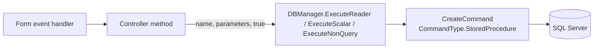
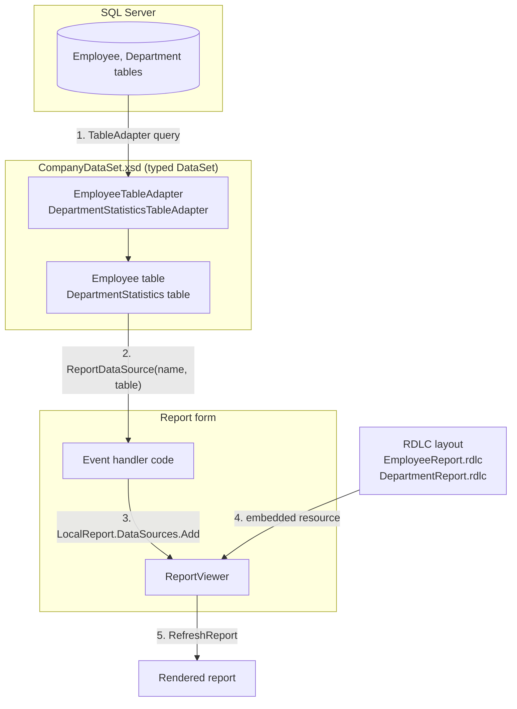
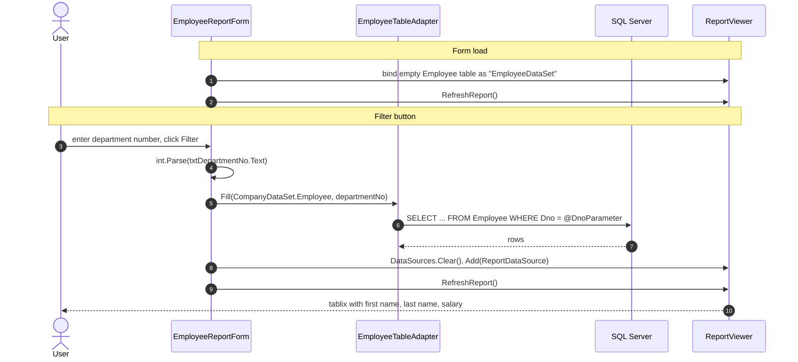
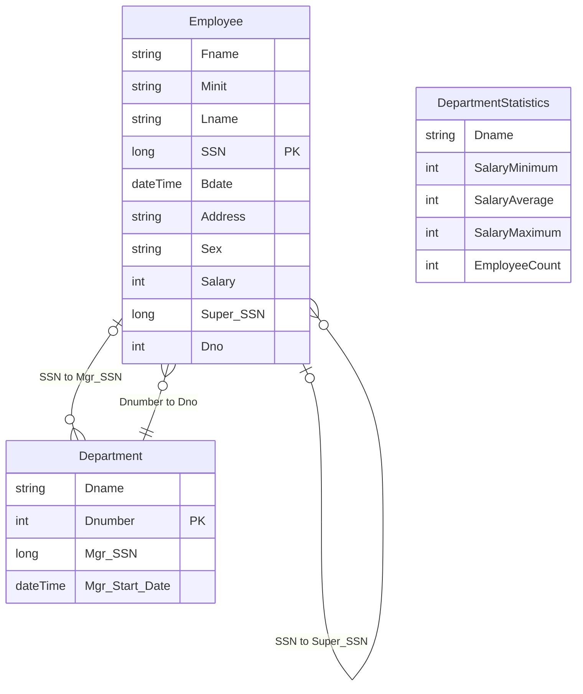
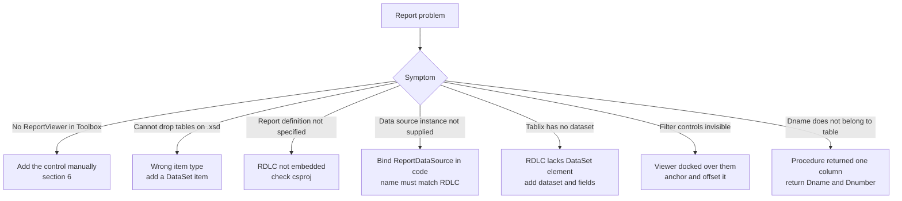

# Lab 6 Reference Guide: Stored Procedures and ReportViewer

Reference notes for the two techniques added in Lab 6: calling SQL Server stored procedures from ADO.NET, and rendering local RDLC reports with ReportViewer. Each section points at the file in this repository that implements it. Paths are relative to `Lab-06/DBapplication/DBapplication/` unless stated otherwise.

## Contents

1. [Stored Procedures](#1-stored-procedures)
2. [Local Reporting Pipeline](#2-local-reporting-pipeline)
3. [The Four Components in This Codebase](#3-the-four-components-in-this-codebase)
4. [DataSet Definition](#4-dataset-definition)
5. [Tablix and Charts in the Reports](#5-tablix-and-charts-in-the-reports)
6. [Designer Setup](#6-designer-setup)
7. [Troubleshooting](#7-troubleshooting)

---

## 1. Stored Procedures

A stored procedure is a named, parameterized batch of T-SQL stored on the server. The client sends the name and parameter values instead of query text.

| Property | Effect |
|---|---|
| Cached execution plan | The server compiles the procedure once and reuses the plan. |
| Smaller requests | Only the name and parameters cross the network. |
| Parameter binding | Values are bound as typed parameters, never concatenated into SQL text. |
| Permissions | `EXECUTE` can be granted on a procedure without granting access to its tables. |
| Single point of change | Join and filter logic can change on the server without redeploying the client. |

### Procedures in this lab

| Procedure | File in `CompanyDB/stored_procedures/` | Purpose |
|---|---|---|
| `getAllEmps` | `getAllEmps.sql` | All employee rows |
| `SelectDepartmentLocation` | `SelectDepartmentLocation.sql` | Distinct department locations |
| `selectDepartmentNum` | `selectDepartmentNum.sql` | `Dname`, `Dnumber` for dropdowns |
| `insertProject` | `insertProject.sql` | Insert a project |
| `selectProjectsofDeptLoc` | `selectProjectsofDeptLoc.sql` | Project and department names for a location |
| `usp_SearchEmployees` | `usp_SearchEmployees.sql` | Search by name or SSN |
| `usp_GetProjectEmployeeCount` | `usp_GetProjectEmployeeCount.sql` | Employees assigned to a project |
| `usp_DeleteProject` | `usp_DeleteProject.sql` | Transactional project delete |
| `usp_DeleteEmployee` | `usp_DeleteEmployee.sql` | Transactional employee delete |

The `usp_` prefix is a naming convention for user procedures. It avoids the `sp_` prefix, which makes SQL Server look in `master` first.

### Syntax used in the scripts

Procedure without parameters (`getAllEmps.sql`):

```sql
CREATE PROCEDURE [dbo].[getAllEmps]
AS
BEGIN
    SET NOCOUNT ON;
    SELECT * FROM Employee;
END
```

Procedure with a parameter (`selectProjectsofDeptLoc.sql`):

```sql
CREATE PROCEDURE [dbo].[selectProjectsofDeptLoc]
    @location VARCHAR(50)
AS
BEGIN
    SET NOCOUNT ON;
    SELECT Pname, Dname
    FROM Department D, Project P, Dept_Locations L
    WHERE P.Dnum = D.Dnumber AND L.Dnumber = D.Dnumber AND L.Dlocation = @location;
END
```

Procedure with a transaction (`usp_DeleteProject.sql`):

```sql
CREATE PROCEDURE [dbo].[usp_DeleteProject]
    @Pnumber INT
AS
BEGIN
    BEGIN TRANSACTION;
    BEGIN TRY
        DELETE FROM Works_On WHERE Pno = @Pnumber;
        DELETE FROM Project WHERE Pnumber = @Pnumber;
        COMMIT TRANSACTION;
    END TRY
    BEGIN CATCH
        ROLLBACK TRANSACTION;
        THROW;
    END CATCH
END
```

Each script is preceded by an `IF OBJECT_ID(...) IS NOT NULL DROP PROCEDURE` guard, so it can be re-run. Changing an existing procedure on a live database is normally done with `ALTER PROCEDURE`, which keeps its permissions. The deployment scripts drop and recreate it instead because they rebuild the whole database.

### Calling a procedure from C#



`DBManager.CreateCommand` ([DBManager.cs](DBapplication/DBapplication/DBManager.cs)) switches the command type when the flag is set:

```csharp
SqlCommand myCommand = new SqlCommand(query, myConnection);
if (isStoredProcedure)
{
    myCommand.CommandType = CommandType.StoredProcedure;
}
if (parameters != null)
{
    foreach (var param in parameters)
    {
        myCommand.Parameters.AddWithValue(param.Key, param.Value ?? DBNull.Value);
    }
}
```

`Controller` passes the procedure name as the query text ([Controller.cs](DBapplication/DBapplication/Controller.cs)):

```csharp
public DataTable SelectALLEmployees()
{
    string query = "getAllEmps";
    return dbMan.ExecuteReader(query, null, true);
}

public int SelectProjEmployeeCount(int PrjNo)
{
    string query = "usp_GetProjectEmployeeCount";
    var parameters = new Dictionary<string, object> { { "@Pnumber", PrjNo } };
    object result = dbMan.ExecuteScalar(query, parameters, true);
    return result == null ? -1 : Convert.ToInt32(result);
}
```

`ExecuteScalar` returns `null` when the call fails, so the controller reports `-1` and the caller can tell a failure from a real count of zero.

Not every query in `Controller` uses a procedure. Insert and update for employees, all supplier operations, the employee filters by department and project, and the supervisor list are still inline parameterized SQL. Employee delete and project delete go through `usp_DeleteEmployee` and `usp_DeleteProject`.

---

## 2. Local Reporting Pipeline

A local report needs four parts: a data source, a typed DataSet, an RDLC layout, and a `ReportViewer` control. The viewer does not query the database. The form fills a `DataTable` and hands it to the viewer under a data source name that the RDLC declares.



### Employee report sequence



The report is empty until a department is entered. Invalid input produces the message "Please enter a valid department number" from the `catch` block in `btnFilter_Click`.

---

## 3. The Four Components in This Codebase

### 3.1 Data source

Employee data comes from `Employee`, through the TableAdapter's parameterized select ([CompanyDataSet.xsd](DBapplication/DBapplication/CompanyDataSet.xsd)):

```sql
SELECT Fname, Minit, Lname, SSN, Bdate, Address, Sex, Salary, Super_SSN, Dno
FROM Employee
WHERE Dno = @DnoParameter
```

The statistics report uses an inline query in the same file, not a stored procedure:

```sql
SELECT Dname,
       MIN(Salary) AS SalaryMinimum,
       CAST(ROUND(AVG(CAST(Salary AS FLOAT)), 0) AS INT) AS SalaryAverage,
       MAX(Salary) AS SalaryMaximum,
       COUNT(SSN)  AS EmployeeCount
FROM Department
INNER JOIN Employee ON Dnumber = Dno
GROUP BY Dnumber, Dname
```

The average is cast to `FLOAT` and rounded before being cast back to `INT`. Without this, `AVG` over an `INT` column truncates the fraction. Grouping by `Dnumber` as well as `Dname` keeps two departments that share a name from being merged.

### 3.2 Typed DataSet

[CompanyDataSet.xsd](DBapplication/DBapplication/CompanyDataSet.xsd) generates `CompanyDataSet` in [CompanyDataSet.Designer.cs](DBapplication/DBapplication/CompanyDataSet.Designer.cs):

```csharp
// EmployeeReportForm.Designer.cs
this.companyDataSet = new DBapplication.CompanyDataSet();
this.employeeTableAdapter = new DBapplication.CompanyDataSetTableAdapters.EmployeeTableAdapter();
this.companyDataSet.DataSetName = "CompanyDataSet";
```

### 3.3 RDLC layout

[EmployeeReport.rdlc](DBapplication/DBapplication/EmployeeReport.rdlc) declares a data source and a dataset, both named `EmployeeDataSet`:

```xml
<DataSet Name="EmployeeDataSet">
  <Query>
    <DataSourceName>EmployeeDataSet</DataSourceName>
    <CommandText>/* Local Query */</CommandText>
  </Query>
  <Fields>
    <Field Name="Fname"><DataField>Fname</DataField>...</Field>
    <!-- Minit, Lname, SSN, Bdate, Address, Sex, Salary, Super_SSN, Dno -->
  </Fields>
</DataSet>
```

[DepartmentReport.rdlc](DBapplication/DBapplication/DepartmentReport.rdlc) uses the dataset name `DepartmentDataSet` with the fields `Dname`, `SalaryMinimum`, `SalaryAverage`, `SalaryMaximum` and `EmployeeCount`.

### 3.4 ReportViewer control

The designer points the control at the embedded resource ([EmployeeReportForm.Designer.cs](DBapplication/DBapplication/EmployeeReportForm.Designer.cs)):

```csharp
this.employeeReportViewer.LocalReport.ReportEmbeddedResource = "DBapplication.EmployeeReport.rdlc";
this.employeeReportViewer.Location = new System.Drawing.Point(0, 40);
```

The code-behind binds the data ([EmployeeReportForm.cs](DBapplication/DBapplication/EmployeeReportForm.cs)):

```csharp
this.employeeTableAdapter.Fill(this.companyDataSet.Employee, departmentNo);

this.employeeReportViewer.LocalReport.DataSources.Clear();
var rds = new Microsoft.Reporting.WinForms.ReportDataSource(
    "EmployeeDataSet",
    (System.Data.DataTable)this.companyDataSet.Employee);
this.employeeReportViewer.LocalReport.DataSources.Add(rds);
this.employeeReportViewer.RefreshReport();
```

> [!IMPORTANT]
> The first argument of `ReportDataSource` must equal the dataset name inside the RDLC (`EmployeeDataSet` or `DepartmentDataSet`). The `CompanyDataSet` type name and the `companyDataSet` field name play no part in the match.

[ViewDepartmentStatistics.cs](DBapplication/DBapplication/ViewDepartmentStatistics.cs) follows the same pattern. It fills `DepartmentStatisticsTableAdapter` in its `Load` handler and binds the result as `DepartmentDataSet`.

---

## 4. DataSet Definition

`CompanyDataSet` has three tables. `Employee` and `Department` mirror the database tables, and `DepartmentStatistics` is the shape of the aggregate query.



| Table | TableAdapter | Notes |
|---|---|---|
| `Employee` | `EmployeeTableAdapter` | Main query filters on `Dno = @DnoParameter`. Also has generated insert, update and delete commands, which the application does not use. |
| `Department` | Generated adapter | Defined in the DataSet but not used by either report. |
| `DepartmentStatistics` | `DepartmentStatisticsTableAdapter` | Read-only aggregate. Departments without employees are omitted because of the `INNER JOIN`. The average is rounded to a whole number to match the `int` column type. |

Both adapters use the connection setting `CompanyDBLab_06ConnectionString`, which resolves to `DBapplication.Properties.Settings.CompanyDBLab_06ConnectionString` in `app.config`. This is a different entry from the `MyConnectionString` used by `DBManager`.

---

## 5. Tablix and Charts in the Reports

A **Tablix** is the RDLC data region that backs tables, matrices and lists. A table is a Tablix with static header rows and a detail row that repeats once per record.

`EmployeeReport.rdlc` contains one Tablix with three columns:

| Column | Header text | Detail expression |
|---|---|---|
| 1 | First Name | `=Fields!Fname.Value` |
| 2 | Last Name | `=Fields!Lname.Value` |
| 3 | Salary | `=Fields!Salary.Value` |

`DepartmentReport.rdlc` contains two charts, both grouped by `=Fields!Dname.Value`:

| Chart | Type | Values |
|---|---|---|
| `Chart1` | Stacked column | `Sum(SalaryMinimum)`, `Sum(SalaryAverage)`, `Sum(SalaryMaximum)` per department |
| `Chart2` | Pie with 3D enabled | `Sum(EmployeeCount)` per department |

Stacking minimum, average and maximum adds the three values together, so the column height itself has no meaning. Read each segment separately.

Both charts still carry the default title text "Chart Title".

---

## 6. Designer Setup

### Packages and toolbox

Install the `Microsoft RDLC Report Designer` extension in Visual Studio (Extensions > Manage Extensions) to edit `.rdlc` files visually. The runtime control comes from NuGet and is already referenced by the project:

```powershell
Install-Package Microsoft.ReportingServices.ReportViewerControl.Winforms
```

If `ReportViewer` is missing from the Toolbox, add it manually:

1. Open a form in the designer, then open the Toolbox.
2. Right-click the Toolbox, choose **Add Tab**, and name it `Reporting`.
3. Right-click inside the tab and choose **Choose Items...**.
4. On the **.NET Framework Components** tab, click **Browse...**.
5. Select `Microsoft.ReportViewer.WinForms.dll` from the package folder under `%USERPROFILE%\.nuget\packages\microsoft.reportingservices.reportviewercontrol.winforms\<version>\lib\`.
6. Confirm that `ReportViewer` is checked, then click **OK**.

### Database connection for the DataSet designer

1. Open **View > Server Explorer**.
2. Right-click **Data Connections** and choose **Add Connection...**.
3. Choose **Microsoft SQL Server**, enter your server name (`.` by default in this project), use Windows Authentication, and select `CompanyDBLab_06`.
4. Use **Test Connection**, then **OK**.
5. Open `CompanyDataSet.xsd` and drag tables from the connection onto the design surface.

The database must exist first. Deploy it with the steps in [README.md](README.md#setup).

### Embedding the reports

The project is SDK-style, so `.rdlc` files are not embedded automatically. [DBapplication.csproj](DBapplication/DBapplication/DBapplication.csproj) lists them explicitly:

```xml
<ItemGroup>
  <EmbeddedResource Include="EmployeeReport.rdlc" />
  <EmbeddedResource Include="DepartmentReport.rdlc" />
</ItemGroup>
```

---

## 7. Troubleshooting

Problems commonly met while building this lab, with their cause and fix.



| Symptom | Cause | Fix |
|---|---|---|
| `ReportViewer` is not in the Toolbox | Visual Studio does not register the control from NuGet automatically. | Add it manually as described in section 6. |
| Dragging tables onto the `.xsd` shows a "cannot drop" cursor | The file was added as a generic XML Schema, which has no database designer. | Remove it and add an ADO.NET **DataSet** item instead. |
| `LocalProcessingException`: the report definition has not been specified | SDK-style projects do not embed `.rdlc` files by default. | Add the `EmbeddedResource` entries shown in section 6. |
| "A data source instance has not been supplied for the data source 'X'" | The viewer has no data bound under the dataset name that the RDLC declares. | Bind a `ReportDataSource` in code with a name equal to the RDLC dataset name, as in section 3.4. |
| "The tablix is in the report body but the report has no dataset" | A hand-written RDLC missing its `DataSets` element. | Add the `DataSet` element and its `Fields`, as in section 3.3. |
| Department textbox and Filter button are not visible | A viewer with `Dock = Fill` covers the form's top controls. | Anchor the viewer on all four sides and set its `Location` to `Y = 40`, as in `EmployeeReportForm.Designer.cs`. |
| "Dname does not belong to table" when choosing the Department filter | The procedure returned only `Dnumber`, but the dashboard reads `Dname` for display and `Dnumber` for value. | `selectDepartmentNum` returns both columns, as in `selectDepartmentNum.sql`. |

### Remaining design-time issues in the repository

- `EmployeeReport.rdlc` declares `Salary` as `System.Decimal` while the column is `INT`. The report still renders.
- The `rd:SchemaPath` entries in the RDLC files point at an old `Lab #5` folder. They affect only the Report Designer and not the running application.
