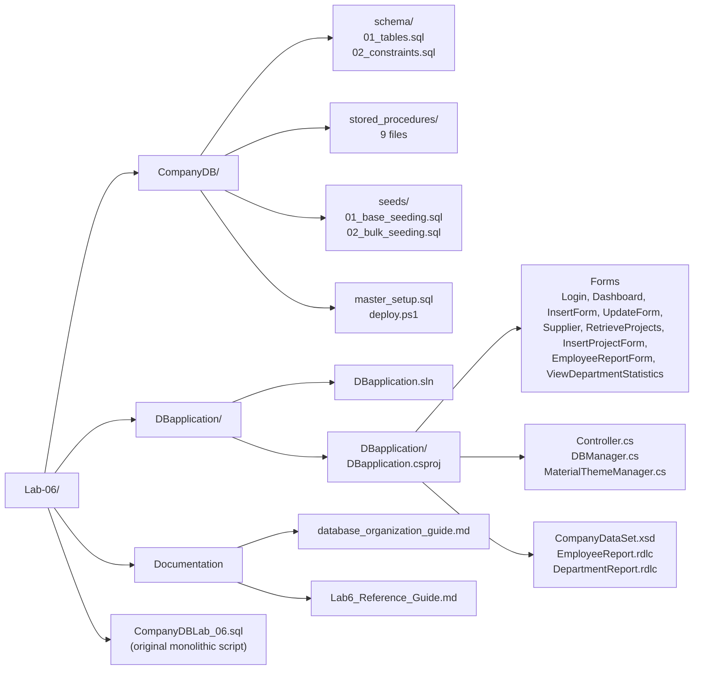
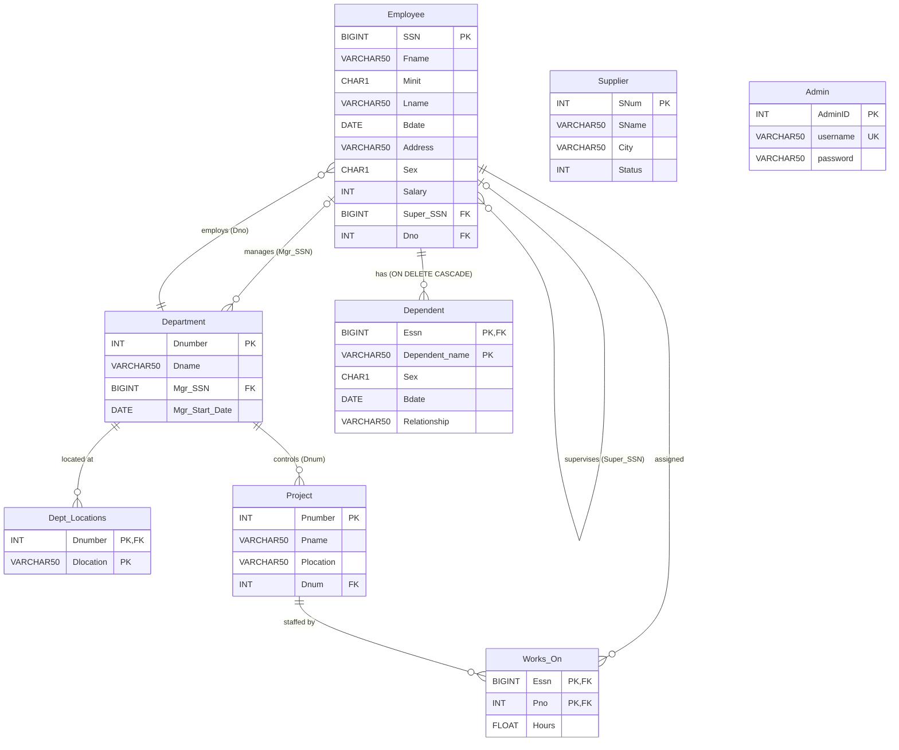
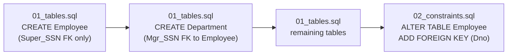
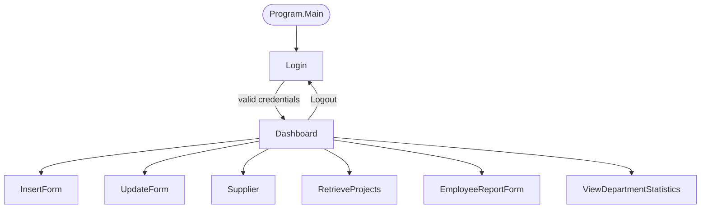
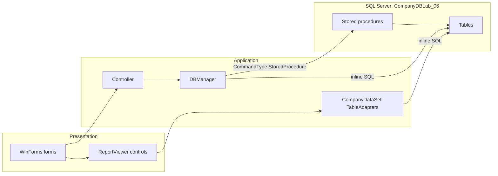
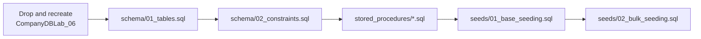

# CompanyDB Management System (Lab 6)

A Windows Forms client for a SQL Server `CompanyDBLab_06` database. The client uses ADO.NET with parameterized commands and stored procedures, and renders two RDLC reports through Microsoft ReportViewer. The database is split into modular SQL scripts that can be deployed with SQLCMD or PowerShell.

## Table of Contents

- [Tech Stack](#tech-stack)
- [Repository Layout](#repository-layout)
- [Database](#database)
- [Application](#application)
- [Architecture](#architecture)
- [Setup](#setup)
- [Building It From Scratch](#building-it-from-scratch)
- [Dependencies](#dependencies)
- [Known Limitations](#known-limitations)
- [Related Documents](#related-documents)

---

## Tech Stack

| Component | Technology | Notes |
|---|---|---|
| Language | C# | `LangVersion` is `latest` |
| Framework | .NET Framework 4.8 | SDK-style project, `UseWindowsForms` |
| UI | WinForms + MaterialSkin.2 2.3.1 | Material theme, light and dark modes |
| Reporting | ReportViewer for WinForms 150.1652.0 | Local RDLC reports, typed `CompanyDataSet` |
| Database | Microsoft SQL Server | Default connection: `Data Source=.` |
| Data access | `System.Data.SqlClient` | Parameterized `SqlCommand`, stored procedures |
| Deployment | SQLCMD and PowerShell | `master_setup.sql`, `deploy.ps1` |
| Platform target | x86 | `PlatformTarget` is `x86` |

---

## Repository Layout



---

## Database

### Entity Relationship Diagram



`Supplier` and `Admin` have no relationships. `Admin` backs the login screen. `Supplier` backs the standalone supplier form.

### Circular Foreign Key

`Employee.Dno` references `Department`, and `Department.Mgr_SSN` references `Employee`. Neither table can be created first with all of its keys, so the schema is applied in two scripts:



Seed data follows the same pattern. `01_base_seeding.sql` inserts employees with `Super_SSN` and `Dno` set to `NULL`, inserts departments, and then patches the two columns with `UPDATE` statements.

### Stored Procedures

All nine procedures live in `CompanyDB/stored_procedures/`, one file each. Every file sets `ANSI_NULLS` and `QUOTED_IDENTIFIER`, drops the procedure if it exists, and creates it as `[dbo].[Name]`.

| Procedure | Parameters | Behavior | Called from |
|---|---|---|---|
| `getAllEmps` | none | `SELECT * FROM Employee` | `Controller.SelectALLEmployees` |
| `SelectDepartmentLocation` | none | Distinct `Dlocation` from `Dept_Locations` | `Controller.SelectDepLoc` |
| `selectDepartmentNum` | none | `Dname`, `Dnumber` from `Department` | `Controller.SelectDepartmentNames` |
| `insertProject` | `@Pname`, `@Pnumber`, `@Plocation`, `@Dnum` | Inserts a `Project` row | `Controller.InsertProject` (via `InsertProjectForm`) |
| `selectProjectsofDeptLoc` | `@location` | `Pname`, `Dname` for projects whose controlling department has a location matching `@location` | `Controller.SelectProject` |
| `usp_SearchEmployees` | `@SearchVal` | Employees whose `Fname` or `Lname` contains the value, or whose `SSN` equals it | `Controller.SearchEmployees` |
| `usp_GetProjectEmployeeCount` | `@Pnumber` | `COUNT(Essn)` from `Works_On` for the project | `Controller.SelectProjEmployeeCount` |
| `usp_DeleteProject` | `@Pnumber` | In one transaction, deletes `Works_On` rows then the `Project` row. Rolls back and rethrows on error | `Controller.DeleteProject` |
| `usp_DeleteEmployee` | `@SSN` | In one transaction, cleans up references in `Works_On`, `Dependent`, `Department.Mgr_SSN`, `Employee.Super_SSN`, then deletes `Employee`. Rolls back and rethrows on error | `Controller.DeleteEmployee` |

`insertProject` is called by `Controller.InsertProject`, which is surfaced through `InsertProjectForm` and accessible from both the Dashboard (project filter actions) and `RetrieveProjects`.

### Seed Data

| Script | Contents |
|---|---|
| `01_base_seeding.sql` | 1 admin (`admin` / `admin`), 8 employees, 3 departments, 5 department locations, 6 projects, 16 work assignments |
| `02_bulk_seeding.sql` | 68 more employees, 33 more departments, 35 locations, 36 projects, 43 work assignments, 8 suppliers, 15 dependents. A final `UPDATE` assigns supervisor `333445555` and department `5` to any employee still without a supervisor, except `888665555` |

The totals are 76 employees and 36 departments.

---

## Application

### Navigation



All secondary forms are opened with `ShowDialog()`. Closing the Dashboard without logging out exits the process.

### Feature Summary

| Area | Behavior | Data path |
|---|---|---|
| Login | Checks `username` and `password` against `Admin` with `SELECT COUNT(AdminID)`. The Enter key submits. A checkbox toggles password visibility. | Inline SQL |
| Employee list | The grid loads through `getAllEmps` and shows friendly column headers. | Stored procedure |
| Search | A non-empty term calls `usp_SearchEmployees`. An empty term reloads the current filter. | Stored procedure |
| Filter by department | The dropdown is filled from `selectDepartmentNum`. The "(All Departments)" entry uses the sentinel `-1`. | Stored procedure and inline SQL |
| Filter by project | The dropdown is filled from `SELECT Pname, Pnumber FROM Project`. Employees come from a `JOIN` on `Works_On`. Choosing a project shows buttons to count its employees, delete it, and open `InsertProjectForm` to create a new project. | Inline SQL and stored procedures |
| Insert employee | Departments and supervisors load from the database. "(No Supervisor)" maps to `NULL`. A blank middle initial is stored as a single space because `Minit` is `NOT NULL`. SSN must be a positive number, salary a non-negative integer (the column is `INT`), and the address is capped at 50 characters (the column is `VARCHAR(50)`). | Inline SQL |
| Update employee | `UpdateForm` prefills the selected row. It builds `UPDATE Employee SET ...` from a parameter dictionary. `SSN` is the key and is not edited. The employee being edited is removed from the supervisor list, and saving with themselves as supervisor is rejected. `Bdate` is sent only if the row had a birth date or the user picks one, so a `NULL` birth date is never overwritten by the picker's default. | Inline SQL |
| Delete employee | Calls `usp_DeleteEmployee`, which in one transaction deletes the employee's `Works_On` and `Dependent` rows, sets `Department.Mgr_SSN` and `Employee.Super_SSN` to `NULL` where they reference the employee, and then deletes the employee. A failure rolls everything back. | Stored procedure |
| Suppliers | Insert, update city, delete, list all, and count. Integer fields are validated before the call. | Inline SQL |
| Projects by location | The location list comes from `SelectDepartmentLocation`. "Execute" runs `selectProjectsofDeptLoc`. Includes an "Add Project" button to open `InsertProjectForm`. | Stored procedures |
| Employee report | Takes a department number and fills `CompanyDataSet.Employee` through `EmployeeTableAdapter` (`WHERE Dno = @DnoParameter`). Shows first name, last name and salary. | Typed DataSet |
| Department statistics | Loads on form open. `DepartmentStatisticsTableAdapter` runs an inline `INNER JOIN` with `GROUP BY Dnumber, Dname`. The average salary is rounded to the nearest integer. The report has a stacked column chart (minimum, average and maximum salary) and a 3D pie chart (employee count). | Typed DataSet |
| Theme | Toggles light and dark mode. The choice is saved to `theme.cfg` next to the executable. | Local file |

Because the statistics query uses `INNER JOIN`, departments with no employees do not appear in the report.

### Theme Behavior

`MaterialThemeManager` is static and shared by every form:

- **Persistence:** `ToggleTheme` writes `DARK` or `LIGHT` to `theme.cfg` in the application base directory. The first form to initialize reads it. A missing or unreadable file means light mode.
- **Title bar:** `DwmSetWindowAttribute` (`dwmapi.dll`, attribute 20) switches the Windows title bar between light and dark. Failures are ignored on older systems.
- **Palette:** Indigo 500 primary, Indigo 700 dark primary, Pink 200 accent, white text.
- **Grids:** `StyleDataGridView` applies the shared grid style. `AutoFitGridColumns` sizes columns to their content and lets `Address`, `Lname`, `SName` or `Pname` fill any remaining width. If none exists, the last visible non-button column fills it.

---

## Architecture



There are two data paths:

- **Forms to `Controller` to `DBManager`.** `Controller` holds one method per operation. It supplies the SQL text or procedure name and a `Dictionary<string, object>` of parameters, and returns a `DataTable` or `int`. It adds no business rules beyond the middle-initial default, and it turns a failed scalar query into `0` (`CheckAdmin`, so login is denied) or `-1` (the two count methods). `DBManager` is the only class that touches `SqlConnection`.
- **Report forms to `CompanyDataSet` TableAdapters.** The two report forms fill typed tables directly and bind them to `ReportViewer`. They do not use `Controller`.

### DBManager

| Member | Behavior |
|---|---|
| Constructor | Reads the `MyConnectionString` entry from `app.config` and opens the connection. A failure shows a message box. |
| `ExecuteReader` | Returns a `DataTable`, or `null` on error. |
| `ExecuteNonQuery` | Returns the affected row count, or `0` on error. |
| `ExecuteScalar` | Returns the first value, or `null` on error. |
| `isStoredProcedure` flag | Sets `CommandType.StoredProcedure` when `true`. |
| `EnsureConnectionOpen` | Reopens a closed or broken connection before each command. |
| `CloseConnection` / `Dispose` | Closes the connection. Each form creates its own `Controller` and closes it in `OnFormClosed`. |

Parameters are added through `AddWithValue`, and `null` values become `DBNull.Value`. Errors are reported with `MessageBox.Show(ex.Message)` and are not rethrown.

---

## Setup

### Prerequisites

| Requirement | Details |
|---|---|
| OS | Windows 10 or 11 |
| .NET Framework | 4.8 targeting pack or developer pack |
| SQL Server | A local default instance (`.`), or any instance you reconfigure below |
| `sqlcmd` | SQL Server command line utilities |
| Build | `dotnet build` or Visual Studio |

### 1. Deploy the database

`deploy.ps1` resolves every file relative to its own location, so it can be started from any directory. `master_setup.sql` uses SQLCMD `:r` includes, which resolve against the working directory, so run it **from inside `CompanyDB/`**.



PowerShell (defaults to server `.`; use `-ServerInstance` to change it):

```powershell
powershell -ExecutionPolicy Bypass -File .\CompanyDB\deploy.ps1
powershell -ExecutionPolicy Bypass -File .\CompanyDB\deploy.ps1 -ServerInstance "(localdb)\MSSQLLocalDB"
```

SQLCMD (`master_setup.sql` is also valid in SSMS with SQLCMD Mode enabled):

```powershell
cd CompanyDB
sqlcmd -S . -i master_setup.sql
```

Either script **drops** `CompanyDBLab_06` if it exists, forcing open sessions closed. See [database_organization_guide.md](database_organization_guide.md) for details.

### 2. Configure the connection

`DBapplication/DBapplication/app.config` defines two connection strings, and both point at `Data Source=.` by default. Change both if your instance differs:

| Name | Used by |
|---|---|
| `MyConnectionString` | `DBManager` (all forms except the report forms) |
| `DBapplication.Properties.Settings.CompanyDBLab_06ConnectionString` | `CompanyDataSet` TableAdapters (the two report forms) |

`CompanyDataSet.xsd` also records the connection in `Properties/Settings.settings`. If you change the server, update it there as well, or the designer will still show the old value.

### 3. Build and run

```powershell
cd DBapplication
dotnet build
```

The executable is `DBapplication/DBapplication/bin/Debug/net48/DBapplication.exe`. Building with an explicit `x86` platform puts it under `bin/x86/Debug/net48/` instead. Sign in with `admin` / `admin`.

> **Verification status:** this revision was checked by reading the scripts and sources. The database scripts and the application were not executed as part of it.

---

## Building It From Scratch

A recipe for rebuilding this application in the same shape. Each step names the file in this repository to copy from or compare against. Do them in order, because each step depends on the one before it.

### Step 1. Prepare the machine

Install Windows 10 or 11, Visual Studio 2022 (with the **.NET desktop development** workload and the .NET Framework 4.8 targeting pack), SQL Server (Express or Developer) and the `sqlcmd` utility. Confirm `sqlcmd -S . -Q "SELECT @@VERSION"` prints a version.

### Step 2. Create the database

1. Create `CompanyDB/schema/01_tables.sql`. Create `Employee` first with only its `Super_SSN` self-reference, then `Department` (with `Mgr_SSN` referencing `Employee`), then `Dept_Locations`, `Project`, `Works_On`, `Admin`, `Supplier` and `Dependent`. Leave `Employee.Dno` without a foreign key, because `Department` does not exist yet.
2. Create `schema/02_constraints.sql` with `ALTER TABLE Employee ADD FOREIGN KEY (Dno) REFERENCES Department(Dnumber)`.
3. Create one file per stored procedure in `stored_procedures/` (the nine listed under [Stored Procedures](#stored-procedures)). Start each with the `IF OBJECT_ID(...) ... DROP PROCEDURE` guard and `GO`, so it can be re-run.
4. Create `seeds/01_base_seeding.sql`: the `admin` login, employees with `Super_SSN` and `Dno` as `NULL`, departments, locations, projects and `Works_On`, then `UPDATE` statements that fill in `Super_SSN` and `Dno`. Create `seeds/02_bulk_seeding.sql` in the same order for the extra rows, suppliers and dependents.
5. Create `master_setup.sql` (SQLCMD `:r` includes) and `deploy.ps1` (one `sqlcmd -b` call per file). Both drop and recreate `CompanyDBLab_06` first. See [database_organization_guide.md](database_organization_guide.md).
6. Run `powershell -ExecutionPolicy Bypass -File .\CompanyDB\deploy.ps1`. It must finish with "Deployment Completed Successfully!".
7. Check it in SSMS or `sqlcmd`: `SELECT COUNT(*) FROM Employee;` should return the seeded employee count (76 for the seeds in this repository).

### Step 3. Create the project

1. In Visual Studio, create a **Windows Forms App (.NET Framework)** project named `DBapplication` targeting .NET Framework 4.8, inside a solution folder `DBapplication/`. Alternatively, start from any WinForms project and make the `.csproj` match [DBapplication.csproj](DBapplication/DBapplication/DBapplication.csproj): SDK-style, `net48`, `UseWindowsForms`.
2. Add the two NuGet packages listed under [Dependencies](#dependencies), pinned to the same versions.
3. Add framework references to `System.Configuration` and `System.Data.DataSetExtensions`.
4. Add `app.config` with the two connection strings from [Configure the connection](#2-configure-the-connection).

### Step 4. Write the data layer

1. **`DBManager`.** Own one `SqlConnection`, opened in the constructor. Provide `ExecuteReader` (returns a `DataTable`), `ExecuteNonQuery` and `ExecuteScalar`, each taking `(string query, Dictionary<string, object> parameters, bool isStoredProcedure)`. Reopen the connection before each command, add parameters with `AddWithValue` (mapping `null` to `DBNull.Value`), catch exceptions, show `ex.Message`, and return `null` or `0` instead of throwing. Reference: [DBManager.cs](DBapplication/DBapplication/DBManager.cs).
2. **`Controller`.** Hold a `DBManager` and expose one method per operation. Pass a procedure name with `true` for stored procedures, or SQL text for inline queries. Convert `ExecuteScalar` results with a null check. Reference: [Controller.cs](DBapplication/DBapplication/Controller.cs).

Keep SQL out of the forms. The forms should only call `Controller`.

### Step 5. Build the shell

1. **`MaterialThemeManager`.** A static helper that initializes MaterialSkin for a form, toggles light and dark mode, saves the choice to `theme.cfg`, and styles `DataGridView` controls. Every MaterialSkin form calls `MaterialThemeManager.Initialize(this)`.
2. **`Login`.** Two text boxes and a button. `CheckAdmin` returns a count, and a value above 0 opens the `Dashboard`. `Program.Main` runs `Login`.
3. **`Dashboard`.** An employee grid, a filter type combo box (None, Department, Project), a value combo box, a search box, and buttons that open the other forms. Use the sentinel `-1` for the "(All …)" entries.

### Step 6. Build the CRUD forms

1. **`InsertForm`** and **`UpdateForm`.** Validate required fields, SSN, and salary (integer) before calling `Controller`. Set text box `MaxLength` values to the column sizes (for example 50 for `Address`, 1 for `Minit`). In `UpdateForm`, remove the edited employee from the supervisor list.
2. **Employee delete** on the `Dashboard`. Confirm, call `usp_DeleteEmployee`, refresh the grid.
3. **`InsertProjectForm`**, **`RetrieveProjects`**, **`Supplier`.** Follow the same pattern. `RetrieveProjects` fills its list from `SelectDepartmentLocation` and shows `selectProjectsofDeptLoc` results.

### Step 7. Add the reports

Follow [Lab6_Reference_Guide.md](Lab6_Reference_Guide.md), section 6 and then sections 2 to 4: add `CompanyDataSet.xsd` with the `Employee` and `DepartmentStatistics` adapters, add the two `.rdlc` files and mark them `EmbeddedResource`, and create `EmployeeReportForm` and `ViewDepartmentStatistics`. The `ReportDataSource` names in code must match the RDLC dataset names exactly.

### Step 8. Verify

Run through this list once:

1. Sign in as `admin` / `admin`. A wrong password shows an error and stays on the login screen.
2. The grid lists the seeded employees. Filtering by department and by project changes the rows.
3. Search for `Smith`. The grid shows matching employees.
4. Insert an employee, edit them, then delete them. Check that the grid refreshes each time.
5. Create a project, then delete it with the Dashboard's project filter.
6. Open Suppliers. Insert, update, delete, list and count all work.
7. Open the project-by-location form and run a location.
8. Open both reports. The statistics report shows the two charts.
9. Toggle the theme, close the app, reopen it, and confirm the theme persists.

---

## Dependencies

| Package | Version | Purpose |
|---|---|---|
| `MaterialSkin.2` | 2.3.1 | Material Design controls and theming |
| `Microsoft.ReportingServices.ReportViewerControl.Winforms` | 150.1652.0 | `ReportViewer` and local RDLC rendering |

Framework references: `System.Configuration` and `System.Data.DataSetExtensions`.

`EmployeeReport.rdlc` and `DepartmentReport.rdlc` are declared as `EmbeddedResource` items in `DBapplication.csproj`. The report forms load them by resource name, for example `DBapplication.EmployeeReport.rdlc`.

---

## Known Limitations

| Item | Detail |
|---|---|
| Plain-text credentials | `Admin.password` is stored and compared as plain text. Acceptable for a lab, not for production. |
| `AddWithValue` | Parameter types are inferred from .NET values. Dates are passed as `yyyy-MM-dd` strings. |
| Dynamic `UPDATE` | `Controller.UpdateEmployee` builds column names from dictionary keys. The keys are fixed in `UpdateForm`, so there is no injection path, but the method trusts its caller. |
| Failure values | `DBManager` shows a message box and returns `0` (`ExecuteNonQuery`) or `null` (`ExecuteReader`, `ExecuteScalar`) instead of throwing. A legitimate `0` rows affected is therefore indistinguishable from an error for non-query calls. |
| Legacy script | `CompanyDBLab_06.sql` is the original single-file setup, kept for reference. The modular `CompanyDB/` scripts are the maintained path. |
| Report types | `EmployeeReport.rdlc` declares `Salary` as `Decimal`, but the column is `INT`. |

---

## Related Documents

| Document | Scope |
|---|---|
| [database_organization_guide.md](database_organization_guide.md) | How the monolithic SQL script was split, execution order, and the two deployment scripts |
| [Lab6_Reference_Guide.md](Lab6_Reference_Guide.md) | Stored procedure concepts, the ReportViewer pipeline, and troubleshooting notes |
