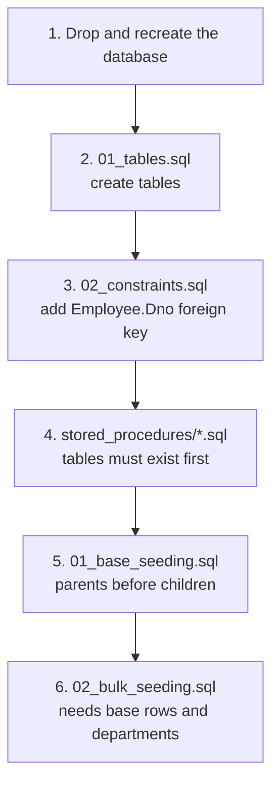
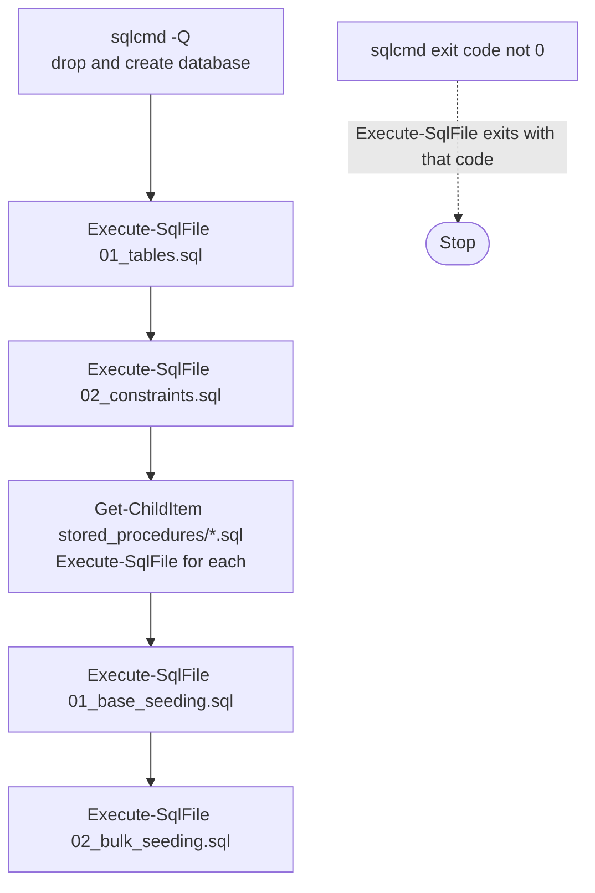

# Database Organization Guide

How the monolithic `CompanyDBLab_06.sql` script was split into the modular `CompanyDB/` layout, why the files must run in a fixed order, and how the two deployment scripts work. Everything here describes files that exist in `CompanyDB/`.

---

## 1. Layout

```mermaid
graph TD
    Root["CompanyDB/"]
    Root --> Schema["schema/"]
    Root --> SP["stored_procedures/"]
    Root --> Seeds["seeds/"]
    Root --> M["master_setup.sql<br/>SQLCMD runner"]
    Root --> D["deploy.ps1<br/>PowerShell runner"]

    Schema --> S1["01_tables.sql<br/>8 tables, FKs except Employee.Dno"]
    Schema --> S2["02_constraints.sql<br/>Employee.Dno foreign key"]

    SP --> P1["getAllEmps.sql"]
    SP --> P2["insertProject.sql"]
    SP --> P3["SelectDepartmentLocation.sql"]
    SP --> P4["selectDepartmentNum.sql"]
    SP --> P5["selectProjectsofDeptLoc.sql"]
    SP --> P6["usp_DeleteProject.sql"]
    SP --> P7["usp_GetProjectEmployeeCount.sql"]
    SP --> P8["usp_SearchEmployees.sql"]
    SP --> P9["usp_DeleteEmployee.sql"]

    Seeds --> D1["01_base_seeding.sql<br/>admin and 8 base employees"]
    Seeds --> D2["02_bulk_seeding.sql<br/>bulk rows, suppliers, dependents"]
```



Grouping by object type keeps diffs small, lets people work on different procedures without touching the same file, and makes the runners simple.

---

## 2. Execution Order

SQL Server enforces dependencies at creation time, so the order is fixed:



| Step | Why it comes here |
|---|---|
| Tables, then constraints | `Employee` and `Department` reference each other. `Employee` is created first with only its supervisor key, then `Department`, then the `Dno` key is added by `ALTER TABLE`. |
| Procedures after tables | SQL Server's deferred name resolution would accept procedures created earlier, but a missing or misspelled table would then only surface at run time. Creating them after the schema keeps problems visible at deployment. |
| Base seed before bulk seed | The bulk script reuses base data: it assigns supervisor `333445555` and refers to base projects 1, 2 and 3 in its `Works_On` rows. Within each script, employees are inserted before the departments they manage, and departments before their locations, projects and work assignments. |
| Employees inserted with `NULL` links | Base and bulk seeds insert employees with `Super_SSN` and `Dno` as `NULL`. They patch both columns with `UPDATE` once the referenced rows exist. |

---

## 3. Deployment Methods

Both methods drop and recreate the database, so they discard any existing data in `CompanyDBLab_06`. `deploy.ps1` resolves its files from its own folder and runs from anywhere. `master_setup.sql` uses SQLCMD `:r` includes, which resolve against the working directory, so run it **from inside `CompanyDB/`**.

### Method A: SQLCMD master script

`master_setup.sql` uses the SQLCMD `:r` directive to read each file into the current batch stream:

```sql
USE master;
GO

IF DB_ID('CompanyDBLab_06') IS NOT NULL
BEGIN
    ALTER DATABASE CompanyDBLab_06 SET SINGLE_USER WITH ROLLBACK IMMEDIATE;
    DROP DATABASE CompanyDBLab_06;
END
GO

CREATE DATABASE CompanyDBLab_06;
GO

USE CompanyDBLab_06;
GO

-- Schema
:r .\schema\01_tables.sql
:r .\schema\02_constraints.sql

-- Stored Procedures (9 files, one :r line each)
:r .\stored_procedures\getAllEmps.sql
-- ...

-- Seed Data
:r .\seeds\01_base_seeding.sql
:r .\seeds\02_bulk_seeding.sql
```

Run it:

```powershell
cd CompanyDB
sqlcmd -S . -i master_setup.sql
```

In SSMS, open the file and enable **Query > SQLCMD Mode** first. The `SINGLE_USER WITH ROLLBACK IMMEDIATE` option disconnects other sessions so the drop cannot be blocked.

The file lists the nine procedures explicitly. A new procedure file must be added here by hand.

### Method B: PowerShell script

`deploy.ps1` runs `sqlcmd` once per file:



```powershell
powershell -ExecutionPolicy Bypass -File .\CompanyDB\deploy.ps1
powershell -ExecutionPolicy Bypass -File .\CompanyDB\deploy.ps1 -ServerInstance "(localdb)\MSSQLLocalDB"
```

The `-ServerInstance` parameter defaults to `.`.

### Comparison

| | SQLCMD (`master_setup.sql`) | PowerShell (`deploy.ps1`) |
|---|---|---|
| Server selection | `-S` on the command line | `-ServerInstance` parameter |
| Procedure discovery | Explicit `:r` per file | Every `*.sql` in `stored_procedures/` |
| Failure handling | Continues on statement errors unless `sqlcmd -b` is passed | Passes `-b` to `sqlcmd` on all invocations and halts execution on failure (`$LASTEXITCODE` check) |
| Working directory | Must be `CompanyDB/` | Any (paths come from `$PSScriptRoot`) |
| Database drop | Same drop and recreate, inside the script | Same drop and recreate, passed to `sqlcmd -Q` with exit code verification |

Both the initial `-Q` drop-and-create call and subsequent `Execute-SqlFile` invocations in `deploy.ps1` pass the `-b` flag to `sqlcmd`, ensuring that syntax errors or statement failures immediately produce a non-zero exit code and abort execution.

---

## 4. Conventions Used in the Scripts

1. **`GO` batch separators.** `CREATE PROCEDURE` must be the first statement in its batch, so every procedure file separates the drop guard, the `CREATE` and the settings with `GO`.
2. **Procedures are re-runnable.** Each file starts with `IF OBJECT_ID('dbo.<name>', 'P') IS NOT NULL DROP PROCEDURE dbo.<name>;`.
3. **Tables are not guarded.** `01_tables.sql` uses plain `CREATE TABLE`. Re-running it against an existing database fails, which is why both runners recreate the database first.
4. **Headers.** Procedure files begin with `SET ANSI_NULLS ON`, `SET QUOTED_IDENTIFIER ON` and a comment block with author, date and description.
5. **No connection details in scripts.** The database name appears only in the runners and the `USE` statement in `master_setup.sql`. The data files rely on the runner having selected the database.

Example procedure file structure (`getAllEmps.sql`):

```sql
SET ANSI_NULLS ON
GO
SET QUOTED_IDENTIFIER ON
GO
-- Author / Create date / Description header

IF OBJECT_ID('dbo.getAllEmps', 'P') IS NOT NULL
    DROP PROCEDURE dbo.getAllEmps;
GO

CREATE PROCEDURE [dbo].[getAllEmps]
AS
BEGIN
    SET NOCOUNT ON;
    SELECT * FROM Employee;
END
GO
```

---

## 5. Adding a New Procedure

1. Create `CompanyDB/stored_procedures/<name>.sql` following the structure above.
2. Add a matching `:r .\stored_procedures\<name>.sql` line to `master_setup.sql`. `deploy.ps1` picks the file up on its own.
3. Add a method to `Controller.cs` that calls it with `isStoredProcedure: true`.
4. Add the procedure to the table in [README.md](README.md#stored-procedures).
5. Redeploy with either runner and call the new `Controller` method from the form to confirm it works.

The legacy single-file script `CompanyDBLab_06.sql` is kept for reference. It also defines the procedures, but the modular files are the maintained source, so make new changes there first.
